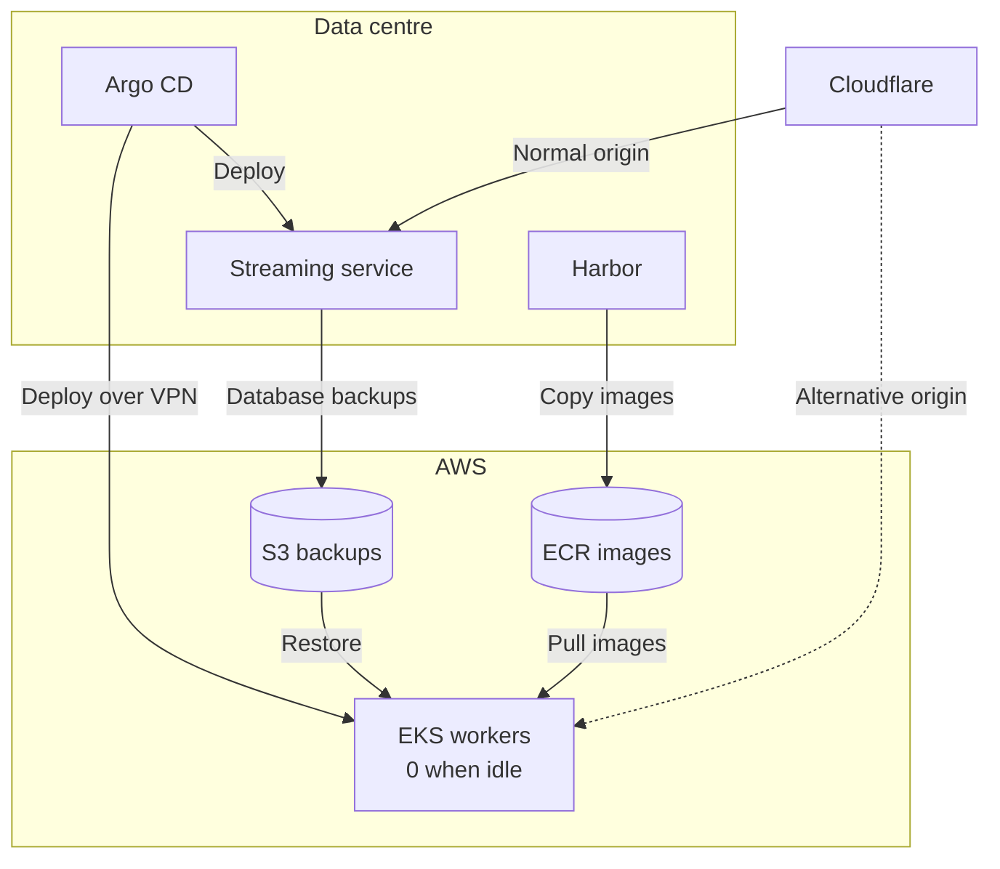
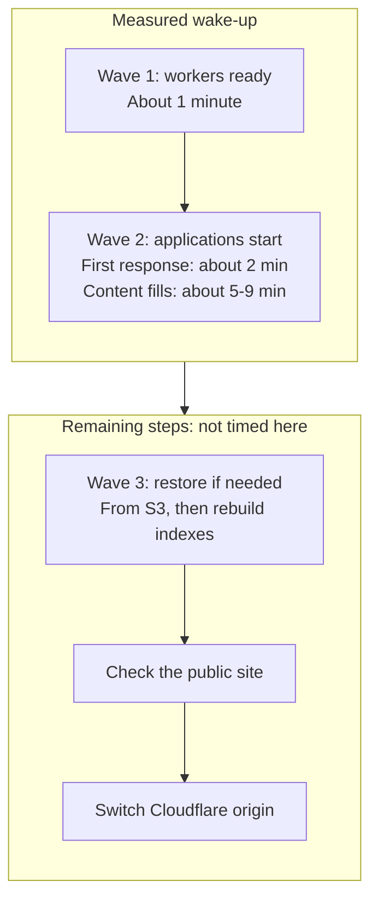

## TL;DR

We reused our Kubernetes and Argo CD setup for a low-cost alternative site for our streaming service. Its workers stay at zero until needed, with an estimated 10–30 minutes to recover (closer to 50 if there are issues) and a target of data no more than 24 hours old.

We have a new mandate at the company to keep functioning even if there are issues in our data centre. For our users, that means getting the public streaming site back while we fix the main site. Audio/Video streaming will also move to a cloud provider so playback can continue. Other functionality, like user login and some other parts are outside this DR setup's scope.

I've spent years putting our Kubernetes architecture in place. We discussed Kubernetes and containers a lot maybe ten years ago, and the resistance was strong, but that choice has paid off a lot over the years. With Argo CD deploying what's defined in Git, deploying to multiple clusters is so easy ... although getting the data there needs a little more thought.

## Reusing what we have

The alternative site runs on a standard Amazon EKS cluster, AWS's managed Kubernetes service, without EKS Auto Mode. Auto Mode would provision workers for pods waiting to run even when we wanted to stay at zero, so we control worker scaling ourselves. We use the same application manifests as production, with small changes to the image registry and storage.

Being able to use those same manifests with a completely new provider is where that choice from ten years ago pays off again. A static site could have done the job too, but future development would have become a parallel project. Now we can keep developing the same applications, and the work benefits both the main site and DR.

Argo CD deploys to both clusters from our data centre, reaching AWS over a VPN. That keeps the normal workflow familiar, but Argo CD can't be a requirement for recovery if the data centre running it is unavailable. The runbook also has to work with AWS CloudShell, the browser-based shell in the AWS console, and `kubectl`.

Database backups go to S3, and container images are copied from Harbor, our image registry, to Amazon ECR. Otherwise our healthy cluster in AWS could be trying to download its applications from the place that just went offline 😅

We agreed the recovered service should look no more than 24 hours old, so I run backups every 12 hours to leave some margin. That's the recovery-point target, or RPO, although the latest successful, usable backup is what actually counts.

*The main flows. The AWS traffic path is simplified here, with its load balancer omitted.*

Cloudflare already handles DNS, TLS and caching, so it's a useful place to change which origin receives traffic. We wake the alternative site, check it, and send traffic there. The switch procedure is outside this articles scope, but safe to say that there is a runbook and some manual steps involved 😉.

## Scaling down to zero

We could leave the alternative site running 24/7, but instead we keep the disks, backups and cluster configuration ready with zero worker nodes. That's the cold part of this disaster recovery setup: ready to start, rather than already running.

The scenario I have in mind is that we've already been down for several hours, we don't see a fix coming soon, and we don't know when the data centre will be back. Going from zero to a functional alternative in something like 10–30 minutes (closer to 50 minutes if there are issues)  feels quite nice in that situation. That's a working estimate for recovery after we decide to start it, including a restore if needed and checks, not a measured end-to-end result.

Zero workers doesn't mean a zero bill, either. The managed control plane, networking, disks and backup storage still cost money, and I haven't verified the full idle-month cost yet. We remove the cost of idle workers.

## Waking it up

I ran a couple of drills, scaling up and back down to check that everything worked. I think of recovery in waves:

- first the nodes come up
- then applications get scheduled and start
- and finally we restore fresh data if needed.

Workers were running after about a minute, the site answered after roughly two, and content rows filled in over about five to nine minutes. Those are elapsed wake-up timings from scale-up, before any fresh restore, checks or traffic switch.

*Only wake-up is measured here. A fresh restore, checks and the traffic switch still need their own time.*

Waking the cluster doesn't automatically restore the newest backup, which wasn't obvious to me when I built this. Our restore uses a Stash `RestoreSession` that runs a Kubernetes Job. Scaling the workers up doesn't create a new session, so a restore completed months ago doesn't run again ... logical when I think about it. For a fresh restore, the runbook empties the database and creates a new `RestoreSession` to restore from S3, followed by rebuilding the search index.

We also found an application caching failed responses, which kept pages empty after the backend was working again. Storage needed adjustments too: on production NFS, a requested volume size hadn't been an enforced limit. A search node requesting 1 GiB was using more than that, and giving it a real 1 GiB disk in AWS made the difference rather obvious ... it ran out of space.

After doing this work, a long-running outage in our data centre feels like less of an issue. Users might be missing login and some other nice features, but we can still serve them ... and the kids can keep learning. We can add those features too, but we'll need to think through how they keep working during an outage.

## Links

- [Argo CD](https://argo-cd.readthedocs.io/en/stable/)
- [Amazon EKS](https://docs.aws.amazon.com/eks/latest/userguide/what-is-eks.html)
- [EKS compute autoscaling](https://docs.aws.amazon.com/eks/latest/userguide/autoscaling.html)
- [AWS CloudShell](https://docs.aws.amazon.com/cloudshell/latest/userguide/welcome.html)
- [Kubernetes Jobs](https://kubernetes.io/docs/concepts/workloads/controllers/job/)
- [Harbor replication](https://goharbor.io/docs/main/administration/configuring-replication/)
