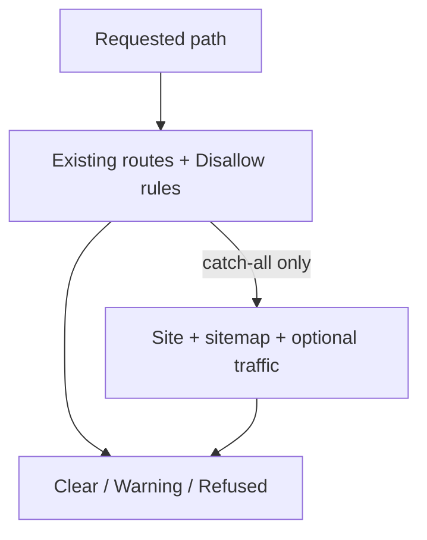
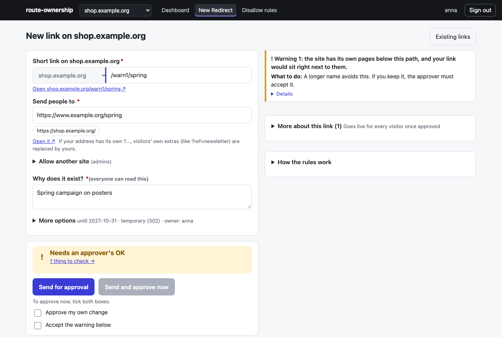
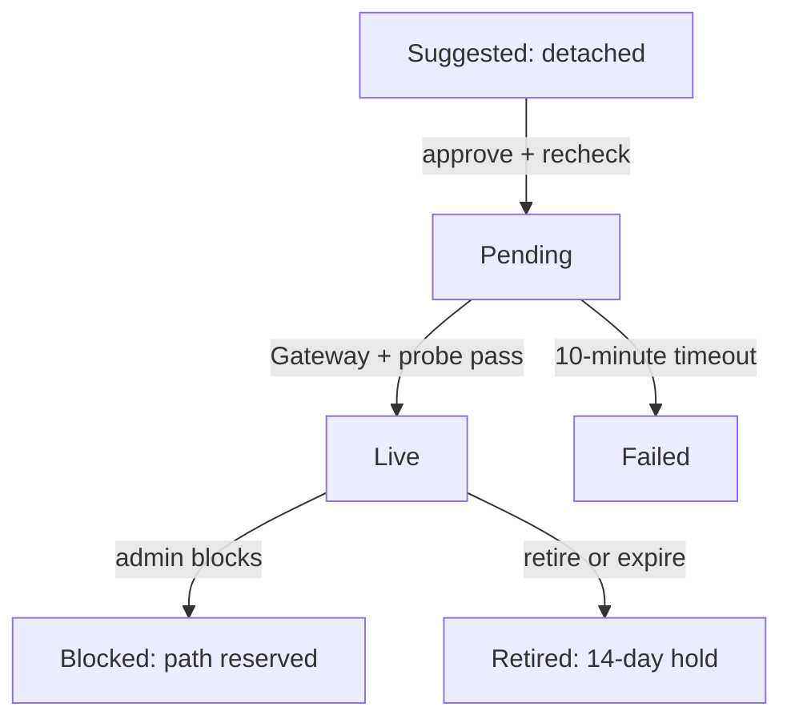

While I was thinking about how to rebuild the URL shortener, we were also standardising on Gateway API's HTTPRoutes as ingress-nginx was being deprecated. Editors have wanted memorable campaign paths on the main domain, but those paths were already shared with the site and its other applications (it was risky, and a lot of manual work each time). I wanted to give them a simple way to ask for a redirect without giving up our ability to manage the domain or shut off one that caused a conflict.

It clicked while I was testing it in our testing cluster and could see the routes, metrics and logs together.

My first two versions failed the job. The first generated shorter, but unmemorable IDs. The second added chosen slugs, login, analytics and a dashboard. It still couldn't see what the site already served, and its separate frontend and backend were awkward to run together. We couldn't safely steer traffic, and marketers still needed us to make their links. I wrote about [those attempts earlier this year](/posts/essay-vanity-url-shorteners/).

## The path is not empty

When an editor asks for `/campaign` on the main domain, that is a claim on a path other systems might already need. Giving the marketing department power over the root domain is scary, because there can be conflicts we don't know about yet, or unexpected things can break.

So the new project is a Kubernetes operator with a web UI. The Gateway is the way into the cluster; HTTPRoutes say where each request goes. A suggested Redirect stays detached from the Gateway while the tool checks it and waits for approval, so it isn't serving yet. With our old ingress-nginx setup, creating the Ingress put it into a very, very large generated NGINX config. It was hard to see if the change was right or what else it might break. Creators suggest, approvers accept, and roles are set per Domain. This is the more holistic version I was looking for.

The check looks at other routes and Redirects, plus the Domain's Disallow rules, the paths administrators have marked off-limits. Only when a catch-all is the sole route does it also use the site's probe and sitemap. Prometheus traffic and Loki access logs can add evidence when configured. A 404 is shown as interest, not occupancy; missing sources add a Warning. No evidence never means free.

Targets must use HTTP or HTTPS, stay within three hops, avoid loops or chains to another Redirect, and use allowed hosts. Private addresses are refused. The form returns Clear, Warning or Refused with its reasoning and next steps, and can suggest Disallow rules from sitemap and served traffic.

## Approval is only the start

Suggestions do not serve anything. They are stored as detached routes, and an approver has to accept one; the checks run again on fresh data at that point. Then the operator writes a Pending route. It becomes Live only after the Gateway accepts it and a probe through the Domain sees the expected redirect. If that does not happen within ten minutes, it becomes Failed, with the reason visible in the tool, but it is not automatically undone.

Every Redirect has an owner, reason, approver and expiry. It expires within a year unless an admin grants an exemption. A retired path stays reserved for at least 14 days by default, so old posters and QR codes don't send people to someone else's campaign. Someone else reusing it gets a warning for the approver to acknowledge.

If a Redirect causes trouble, an admin can block it directly. The route stops serving, but the path stays reserved while we sort out the conflict.

## What we have to trust

In Git mode, ArgoCD applies each committed change and the operator reads it back. The route carries a signed record; the trusted one is in the operator's ledger. Live routes are rechecked every five minutes and after route or Domain changes, but not for traffic. With ArgoCD, outside edits are flagged for an approver rather than reverted. The repo still needs protection: someone with write access can reattach a blocked or retired Redirect, which may serve until detached again.

Giving editors access to the root domain is still scary. The sitemap can miss pages and traffic misses visits answered from a cache. New route conflicts are flagged, but the team still decides what to do.

I've tested it in our testing cluster. Now it needs to be tested with actual editors and campaigns. I think it might actually solve the redirect issue ... and I hope it will just work for them. We'll see.

## Links

- [The hard part of vanity URLs is not the redirect](/posts/essay-vanity-url-shorteners/)
- [Gateway API](https://gateway-api.sigs.k8s.io/)
- [Prometheus documentation](https://prometheus.io/docs/introduction/overview/)
- [Grafana Loki documentation](https://grafana.com/docs/loki/latest/)