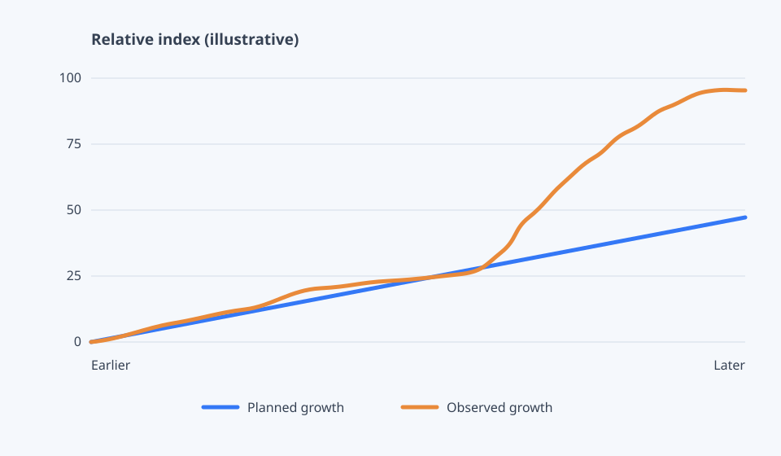

We were preparing for growth when a user chart showed a jump we hadn't seen before. It wasn't remarkable globally, but it was new for us, so we checked the database.

*Illustrative curve only; the dates, counts and index are not real.*

Each client replica had its own pool. I added those caps together and compared the total with Postgres's `max_connections`, leaving room for backups and other clients. A full pool makes requests wait and eventually time out; a full Postgres refuses new connections.

The pool wasn't the whole story. `shared_buffers` is memory Postgres uses for its cache. `effective_cache_size` only informs the planner about cache it may find in Postgres and the operating system; it reserves nothing. `work_mem` applies per sort or hash operation, not per server. Concurrent queries can multiply it, while too little spills to temporary files. Raising it carelessly can trade disk I/O for memory pressure.

We checked `checkpoint_completion_target` too: it spreads dirty-page writes across the checkpoint interval, smoothing I/O rather than avoiding it. To judge the changes, we compared buffer hits, reads per transaction and temporary-file bytes. Traffic was lower in the comparison period, so raw totals would mislead us. Cache hits improved, reads per transaction fell, and temporary writes stopped after the `work_mem` change.

**What I learned:** a database doesn't have one performance knob. I had to budget connections across replicas, size memory for the container and workload, and measure reads and spills separately. So we changed a few things and checked what moved... we'll see how it holds up as usage grows.

## Links

- [PostgreSQL connection settings](https://www.postgresql.org/docs/current/runtime-config-connection.html), including `max_connections`
- [PostgreSQL resource consumption](https://www.postgresql.org/docs/current/runtime-config-resource.html), including `shared_buffers` and `work_mem`
- [PostgreSQL query planning](https://www.postgresql.org/docs/current/runtime-config-query.html), including `effective_cache_size`
- [PostgreSQL WAL configuration](https://www.postgresql.org/docs/current/wal-configuration.html), including checkpoint pacing
